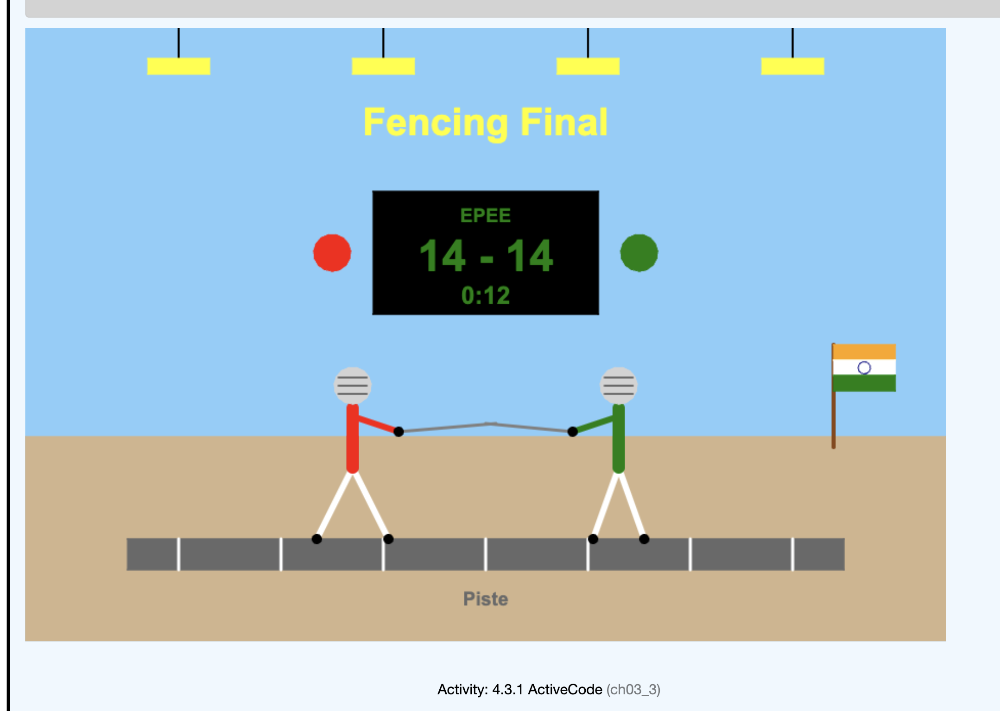

# comp115_project1

 Fencing Final - Python Turtle Drawing

This is my COMP 115 Project 1. I used Python's turtle module to draw a fencing match.

## What is in the drawing
- A fencing piste (strip) in the middle
- Two épée fencers facing each other (one red, one green)
- A scoreboard showing the score 14 - 14 and the timer 0:12
- Overhead arena lights
- A small Indian flag
- The title "Fencing Final"

## How the code works
I split the drawing into functions so I did not repeat code:
- `draw_background()` draws the floor
- `draw_lights()` draws the ceiling lights using a for loop
- `draw_title()` writes the title
- `draw_piste()` draws the strip and white lines using a for loop
- `draw_scoreboard()` draws the scoreboard, score, and timer
- `draw_flag()` draws the Indian flag
- `draw_fencer()` draws one fencer. I call it twice with different
  values so the two fencers look different.

## Python concepts used
Functions, parameters, for loops, coordinates, fill colors, pen size.

## How to run
1. Install Python.
2. Download `fencing_project.py`.
3. Run `python fencing_project.py`.
